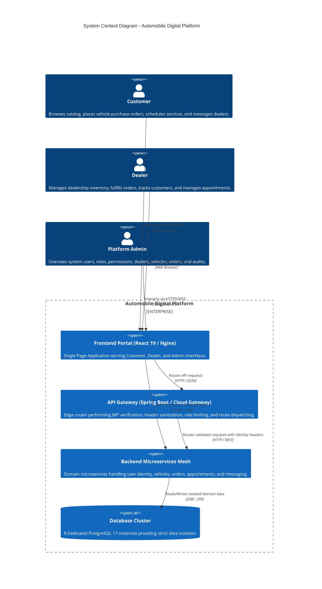
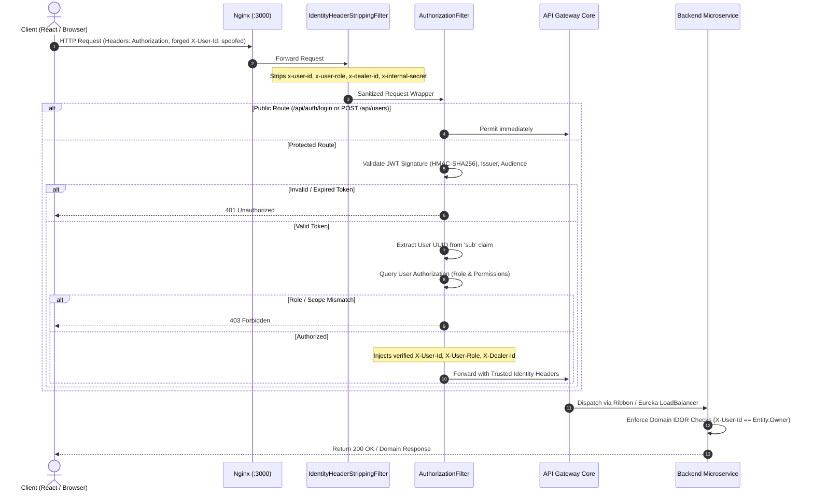
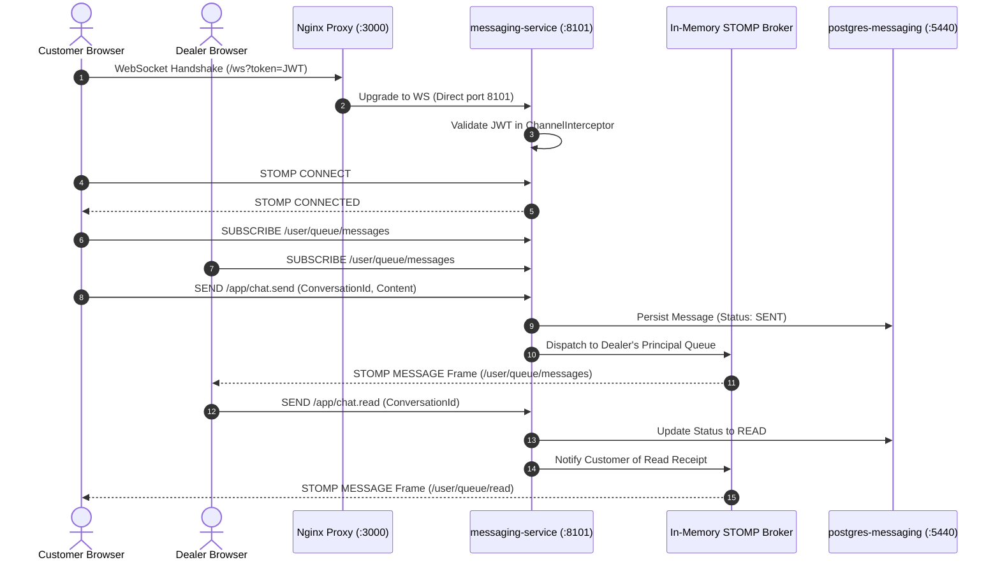
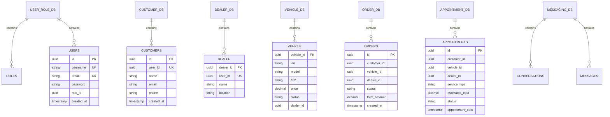

# Automobile Digital Platform — Architecture Specification

## 1. Executive Architectural Overview

The **Automobile Digital Platform** is an enterprise-grade automotive retail, dealership management, vehicle ordering, service appointment scheduling, and customer engagement platform. It is engineered following a cloud-native microservices pattern with strict **database-per-service isolation**, **service discovery via Netflix Eureka**, **unified API routing & security through Spring Cloud Gateway**, and a **Single Page Application (SPA) frontend in React 19 / TypeScript** delivered via **Nginx**.

```
+-----------------------------------------------------------------------------------+
|                                  CLIENT LAYER                                     |
|           React 19 + TypeScript + Vite + Tailwind CSS + React Router 7            |
+-----------------------------------------+-----------------------------------------+
                                          | HTTP / REST (port 3000)
                                          v
+-----------------------------------------------------------------------------------+
|                                  GATEWAY / PROXY                                  |
|                             Nginx (Reverse Proxy :3000)                           |
|             SPA Static Files  |  /api/** & /dealers/**  |  /ws (WebSocket)        |
+--------------------+--------------------+--------------------+--------------------+
                     |                    |                    |
                     |                    | (HTTP Proxy :8080) | (Direct WS :8101)
                     |                    v                    |
+--------------------+-----------------------------------------+--------------------+
|                               API GATEWAY LAYER                                   |
|              Spring Cloud Gateway Server WebMVC (Port 8080)                       |
|   - IdentityHeaderStrippingFilter (Strips forged X-User-*, X-Internal-Secret)     |
|   - AuthorizationFilter (JWT Bearer Token validation, RBAC, Tenant Scoping)       |
|   - Eureka Client with dynamic IP instance resolution                             |
+-----------------------------------------+-----------------------------------------+
                                          | Internal Service Calls
                                          v
+-----------------------------------------------------------------------------------+
|                             MICROSERVICES MESH LAYER                              |
|                                                                                   |
|  +-------------------+  +-------------------+  +-------------------------------+  |
|  | user-role-service |  |  customer-service |  |         dealer-service        |  |
|  |    Port: 8092     |  |    Port: 8081     |  |           Port: 8083          |  |
|  +---------+---------+  +---------+---------+  +---------------+---------------+  |
|            |                      |                            |                  |
|  +---------+---------+  +---------+---------+  +---------------+---------------+  |
|  |  vehicle-service  |  |   order-service   |  |   service-appointment-service |  |
|  |    Port: 8084     |  |    Port: 8082     |  |           Port: 8100          |  |
|  +---------+---------+  +---------+---------+  +---------------+---------------+  |
|            |                      |                            |                  |
|  +---------+---------+  +---------+---------+                  |                  |
|  | permission-service|  | messaging-service |                  |                  |
|  |    Port: 8091     |  |    Port: 8101     |                  |                  |
|  +---------+---------+  +---------+---------+                  |                  |
|                                                                |                  |
|  +-------------------------------------------------------------+---------------+  |
|  |                 Service Registry: Netflix Eureka (:8761)                    |  |
|  +-----------------------------------------------------------------------------+  |
+-----------------------------------------+-----------------------------------------+
                                          | Dedicated JDBC Connections
                                          v
+-----------------------------------------------------------------------------------+
|                        ISOLATED DATABASE PERSISTENCE LAYER                        |
|                     8 Independent PostgreSQL 17 Containers                        |
|                                                                                   |
|  [user_role_db]      [customer]         [dealer_db]        [vehicle_db]           |
|   Port: 5439          Port: 5434         Port: 5435         Port: 5436            |
|                                                                                   |
|  [order]             [service_apptmnt]  [permission_db]    [messaging]            |
|   Port: 5433          Port: 5437         Port: 5438         Port: 5440            |
+-----------------------------------------------------------------------------------+
```

---

## 2. High-Level System Context (C4 Context Diagram)



---

## 3. Microservice Decomposition & Inventory

The platform decomposes business capabilities into 8 independent, single-responsibility microservices and 2 supporting infrastructure services:

| Component | Container Name | Service Port | DB Port | Technology | Database Name | Primary Responsibility |
| :--- | :--- | :--- | :--- | :--- | :--- | :--- |
| **API Gateway** | `api-gateway` | 8080 | N/A | Spring Cloud Gateway WebMVC | None | Central ingress, JWT validation, header sanitization, RBAC filter |
| **Service Registry** | `eureka-server` | 8761 | N/A | Netflix Eureka | None | Dynamic service registration and heartbeat health monitoring |
| **User & Role** | `user-role-service` | 8092 | 5439 | Spring Boot 4.1.1 / JPA | `user_role_db` | User identity, BCrypt credentials, RBAC roles, JWT minting |
| **Customer** | `customer-service` | 8081 | 5434 | Spring Boot 4.1.1 / JPA | `customer` | Customer profile management, customer onboarding, addresses |
| **Dealer** | `dealer-service` | 8083 | 5435 | Spring Boot 4.1.1 / JPA | `dealer_db` | Regional dealership profiles, dealer-scoped orders and appointments |
| **Vehicle** | `vehicle-service` | 8084 | 5436 | Spring Boot 4.1.1 / JPA | `vehicle_db` | Master vehicle catalog, VIN tracking, inventory status, pricing |
| **Order** | `order-service` | 8082 | 5433 | Spring Boot 4.1.1 / JPA | `order` | Vehicle purchase workflows, order state machines, sales tracking |
| **Service Appt** | `service-appointment` | 8100 | 5437 | Spring Boot 4.1.1 / JPA | `service_appointment` | Workshop bookings, service types, repair status, cost quotes |
| **Permission** | `permission-service` | 8091 | 5438 | Spring Boot 4.1.1 / JPA | `permission_db` | Fine-grained functional permission tokens and assignments |
| **Messaging** | `messaging-service` | 8101 | 5440 | Spring Boot / WebSocket | `messaging` | Real-time STOMP chat, thread management, unread counts, receipts |
| **Frontend** | `frontend` | 3000 (mapped to 80) | N/A | React 19 / Vite / Nginx | None | Responsive UI for Customer, Dealer, and Admin personas |

---

## 4. Ingress & Routing Architecture

### 4.1 Nginx Reverse Proxy (`Frontend-main/nginx.conf`)
Traffic entering port `3000` is received by Nginx running in the `frontend` container:
1. **Static SPA Delivery**: Resolves static assets from `/usr/share/nginx/html`. Any non-matching route falls back to `/index.html` via `try_files $uri $uri/ /index.html`.
2. **Dynamic DNS Upstream Resolution**: Uses `resolver 127.0.0.11 valid=10s ipv6=off;` and assigns upstreams to dynamic variables (`set $gateway_upstream http://api-gateway:8080;`). This prevents stale IP caching when Docker containers are recreated.
3. **REST API Forwarding**: Proxies `/api/*` and `/dealers/*` to `http://api-gateway:8080`.
4. **WebSocket Bypassing**: Proxies `/ws` directly to `http://messaging-service:8101` with `Upgrade` and `Connection: upgrade` headers, because Spring Cloud Gateway Server WebMVC does not natively proxy raw WebSocket STOMP handshakes.

### 4.2 Spring Cloud Gateway Route Table
Configured in `api-gateway/src/main/resources/application.properties`:
- `Path=/api/auth/**,/api/users/**,/api/roles/**` &rarr; `lb://user-role-service`
- `Path=/api/permissions/**` &rarr; `lb://permission-service`
- `Path=/api/vehicles/**` &rarr; `lb://vehicle-service`
- `Path=/api/v1/customers/**` &rarr; `lb://customer`
- `Path=/api/v1/orders/**` &rarr; `lb://order-service`
- `Path=/dealers/**` &rarr; `lb://dealer-service`
- `Path=/api/appointments/**` &rarr; `lb://service-appointment`
- `Path=/api/messages/**` &rarr; `lb://messaging-service`

---

## 5. Security & Trust Architecture



### Key Security Defenses:
1. **Header Stripping**: External callers cannot spoof `X-User-Id`, `X-User-Role`, `X-Dealer-Id`, or `X-Internal-Secret`. Any such incoming headers are discarded at highest filter precedence.
2. **Server-Side Identity Verification**: Backend microservices never trust arbitrary IDs supplied in URL query parameters or JSON bodies. They verify identity against the Gateway-injected headers.
3. **Internal Secret Token**: Endpoints meant strictly for inter-service communication (such as `/api/internal/users/**`) require the HTTP header `X-Internal-Secret: <INTERNAL_SERVICE_SECRET>`. The Gateway explicitly blocks routing to internal paths from outside.

---

## 6. Service Discovery & Load Balancing (Eureka)

1. **Instance Prefer IP Address**: `EUREKA_INSTANCE_PREFER_IP_ADDRESS=true` is enabled across all services. When Docker recreates containers with new internal IPs, Eureka publishes IP addresses rather than transient container hostnames, preventing stale DNS lookups.
2. **Aggressive Heartbeats**:
   - `lease-renewal-interval-in-seconds`: 10s
   - `lease-expiration-duration-in-seconds`: 30s
   - `registry-refresh-interval-seconds`: 10s
   - Gateway load balancer cache TTL is set to 5 seconds (`spring.cloud.loadbalancer.cache.ttl=5s`), ensuring failovers complete within seconds without downtime.

---

## 7. Real-Time Messaging Architecture



---

## 8. Database-Per-Service Architecture

Each domain is strictly isolated to its own database schema and PostgreSQL instance:



No cross-database foreign keys exist. Referential integrity across microservices is maintained via domain logic and validated through the API Gateway and OpenFeign / RestClient inter-service lookups.
