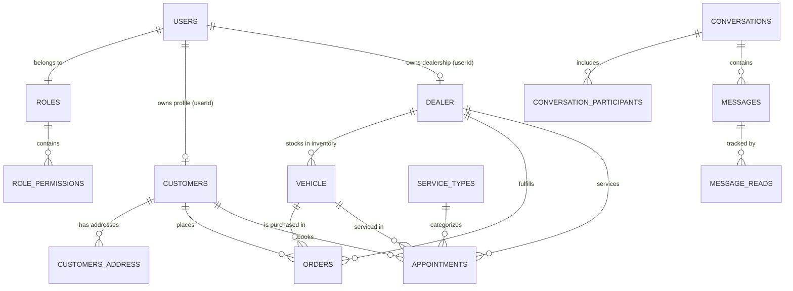

# Automobile Digital Platform — Database Design Specification

## 1. Architectural Philosophy: Database-per-Service

The **Automobile Digital Platform** implements the **Database-per-Service** pattern to achieve strict domain boundaries, loose coupling, independent scalability, and autonomous data evolution.

```
       [ Client Applications ]
                  |
         [ API Gateway :8080 ]
                  |
     +------------+------------+---------------------------------+
     |            |            |                                 |
 [customer]    [order]      [dealer]                          [vehicle]
     |            |            |                                 |
     v            v            v                                 v
[postgres-   [postgres-   [postgres-                        [postgres-
 customer]     order]       dealer]                           vehicle]
  (:5434)      (:5433)      (:5435)                           (:5436)
```

### Key Rationale:
1. **Zero Runtime Coupling**: A maintenance restart or performance degradation in `postgres-messaging` or `postgres-vehicle` never cascades to disrupt `postgres-user-role` or `postgres-order`.
2. **Schema Autonomy**: Individual teams or services can evolve schema fields (e.g. adding workshop service types or chat read receipts) without schema locking across unrelated tables.
3. **Physical Isolation & Security**: The database credentials for `customer` cannot read tables in `order` or `user_role_db`.
4. **Resilient Initialization**: Each service utilizes Hibernate auto-DDL (`spring.jpa.hibernate.ddl-auto=update`) followed by idempotent SQL seed initialization (`spring.sql.init.data-locations=classpath:seed.sql` with `ON CONFLICT DO NOTHING`).

---

## 2. Complete Database & Table Inventory

The platform orchestrates 8 independent PostgreSQL 17 database containers:

| Database Container | Host Port | Internal Port | Database Name | Managed Tables |
| :--- | :--- | :--- | :--- | :--- |
| `postgres-order` | 5433 | 5432 | `order` | `orders` |
| `postgres-customer` | 5434 | 5432 | `customer` | `customers`, `customers_address` |
| `postgres-dealer` | 5435 | 5432 | `dealer_db` | `dealer` |
| `postgres-vehicle` | 5436 | 5432 | `vehicle_db` | `vehicle` |
| `postgres-service-appointment` | 5437 | 5432 | `service_appointment` | `appointments`, `service_types` |
| `postgres-permission` | 5438 | 5432 | `permission_db` | `permissions` |
| `postgres-user-role` | 5439 | 5432 | `user_role_db` | `users`, `roles`, `role_permissions` |
| `postgres-messaging` | 5440 | 5432 | `messaging` | `conversations`, `conversation_participants`, `messages`, `message_reads` |

---

## 3. Detailed Database Schemas

### 3.1 Database: `user_role_db` (Port: 5439)

#### Table: `roles`
Stores authorization security roles.
- `id` (`UUID`, Primary Key, Not Null)
- `name` (`VARCHAR(255)`, Unique, Not Null) - e.g., `ADMIN`, `DEALER`, `CUSTOMER`
- `description` (`VARCHAR(500)`, Nullable) - Purpose and scope of the role

#### Table: `role_permissions`
Join collection table mapping roles to permission identifiers.
- `role_id` (`UUID`, Foreign Key referencing `roles.id`, Not Null)
- `permission_id` (`UUID`, Not Null) - Reference to `permission_db.permissions.id`

#### Table: `users`
Master user authentication accounts.
- `id` (`UUID`, Primary Key, Generated UUID, Not Null)
- `username` (`VARCHAR(255)`, Unique, Not Null)
- `name` (`VARCHAR(255)`, Not Null) - Display name
- `email` (`VARCHAR(255)`, Unique, Not Null) - Login identifier
- `password` (`VARCHAR(255)`, Not Null) - BCrypt hashed password (`$2a$10$...` / `$2b$10$...`)
- `role_id` (`UUID`, Not Null) - References `roles.id`
- `created_at` (`TIMESTAMP`, Not Null) - Account creation timestamp

---

### 3.2 Database: `customer` (Port: 5434)

#### Table: `customers`
Customer demographic and profile details.
- `id` (`UUID`, Primary Key, Generated UUID, Not Null)
- `user_id` (`UUID`, Unique, Nullable) - Logical link to `user_role_db.users.id`
- `name` (`VARCHAR(255)`, Nullable)
- `email` (`VARCHAR(255)`, Not Null)
- `phone` (`VARCHAR(255)`, Nullable)
- `created_at` (`TIMESTAMP`, Nullable) - Join date

#### Table: `customers_address`
Element collection storing multi-line physical addresses.
- `customers_id` (`UUID`, Foreign Key referencing `customers.id`, Not Null)
- `address` (`VARCHAR(255)`, Nullable) - Address street/city line

---

### 3.3 Database: `dealer_db` (Port: 5435)

#### Table: `dealer`
Regional dealership facilities.
- `dealer_id` (`UUID`, Primary Key, Generated UUID, Not Null)
- `user_id` (`UUID`, Unique, Nullable) - Logical link to `user_role_db.users.id`
- `name` (`VARCHAR(255)`, Nullable) - e.g., `BMW Chennai`, `BMW Bangalore`
- `location` (`VARCHAR(255)`, Nullable) - City name (Chennai, Bangalore, Hyderabad, Mumbai, Delhi)

---

### 3.4 Database: `vehicle_db` (Port: 5436)

#### Table: `vehicle`
Master vehicle catalog and physical inventory.
- `vehicle_id` (`UUID`, Primary Key, Generated UUID, Not Null)
- `vin` (`VARCHAR(255)`, Nullable) - 17-character Vehicle Identification Number
- `model` (`VARCHAR(255)`, Nullable) - Model designation (e.g., "M3 Competition", "i4 Gran Coupe")
- `trim` (`VARCHAR(255)`, Nullable) - Edition / package
- `color` (`VARCHAR(255)`, Nullable) - Exterior finish (e.g., "Isle of Man Green")
- `price` (`NUMERIC(19, 2)`, Nullable) - Retail price in INR (e.g., `6800000.00`)
- `status` (`VARCHAR(50)`, Nullable) - Enumeration: `AVAILABLE`, `RESERVED`, `SOLD`
- `dealer_id` (`UUID`, Nullable) - Logical assignment to a dealership
- `mileage` (`INTEGER`, Nullable) - Odometer reading
- `image` (`VARCHAR(255)`, Nullable) - Path to asset image (e.g., `/vehicles/m3.png`)
- `body_type` (`VARCHAR(255)`, Nullable) - Sedan, Coupe, SUV, Gran Coupe
- `engine` (`VARCHAR(255)`, Nullable) - 3.0L BMW M TwinPower Turbo inline 6-cylinder
- `transmission` (`VARCHAR(255)`, Nullable) - 8-speed M Steptronic
- `fuel_type` (`VARCHAR(255)`, Nullable) - Petrol, Diesel, Electric
- `description` (`VARCHAR(1000)`, Nullable) - Vehicle overview

---

### 3.5 Database: `order` (Port: 5433)

#### Table: `orders`
Vehicle purchase records.
- `id` (`UUID`, Primary Key, Generated UUID, Not Null)
- `customer_id` (`UUID`, Not Null) - Logical reference to `customers.id`
- `vehicle_id` (`UUID`, Not Null) - Logical reference to `vehicle.vehicle_id`
- `dealer_id` (`UUID`, Not Null) - Logical reference to `dealer.dealer_id`
- `status` (`VARCHAR(50)`, Not Null) - Lifecycle: `CREATED`, `CONFIRMED`, `IN_PRODUCTION`, `SHIPPED`, `DELIVERED`, `CANCELLED`
- `total_amount` (`NUMERIC(19, 2)`, Not Null) - Total price in INR
- `created_at` (`TIMESTAMP`, Not Null) - Timestamp when order was placed

---

### 3.6 Database: `service_appointment` (Port: 5437)

#### Table: `appointments`
Workshop service bookings.
- `id` (`UUID`, Primary Key, Generated UUID, Not Null)
- `customer_id` (`UUID`, Not Null) - Reference to `customers.id`
- `vehicle_id` (`UUID`, Nullable) - Reference to `vehicle.vehicle_id`
- `dealer_id` (`UUID`, Not Null) - Reference to `dealer.dealer_id`
- `appointment_date` (`TIMESTAMP`, Not Null) - Scheduled date and time
- `service_type` (`VARCHAR(64)`, Not Null) - Code referencing `service_types.code`
- `estimated_cost` (`NUMERIC(19, 2)`, Nullable) - Quoted workshop estimate
- `status` (`VARCHAR(50)`, Not Null) - State: `REQUESTED`, `CONFIRMED`, `IN_PROGRESS`, `COMPLETED`, `CANCELLED`

#### Table: `service_types`
Master catalog of valid workshop services.
- `code` (`VARCHAR(64)`, Primary Key, Not Null) - e.g., `OIL_CHANGE`, `INSPECTION`, `BRAKE_SERVICE`
- `label` (`VARCHAR(120)`, Not Null) - Human readable label
- `description` (`VARCHAR(400)`, Nullable) - Service description
- `active` (`BOOLEAN`, Not Null) - Whether available for booking

---

### 3.7 Database: `permission_db` (Port: 5438)

#### Table: `permissions`
Master list of atomic permissions.
- `id` (`UUID`, Primary Key, Generated UUID, Not Null)
- `name` (`VARCHAR(255)`, Unique, Not Null) - e.g., `VEHICLE_CREATE`, `ORDER_UPDATE`, `DEALER_VIEW`
- `description` (`VARCHAR(255)`, Nullable)

---

### 3.8 Database: `messaging` (Port: 5440)

#### Table: `conversations`
Chat discussion threads.
- `id` (`UUID`, Primary Key, Generated UUID, Not Null)
- `title` (`VARCHAR(255)`, Nullable) - Subject line
- `context_type` (`VARCHAR(50)`, Nullable) - Context: `GENERAL`, `ORDER`, `VEHICLE`, `SERVICE`
- `context_id` (`UUID`, Nullable) - Optional reference to related order/vehicle/appointment
- `created_at` (`TIMESTAMP`, Nullable)
- `updated_at` (`TIMESTAMP`, Nullable)
- `last_message_at` (`TIMESTAMP`, Nullable)

#### Table: `conversation_participants`
Join collection table for multi-party chat membership.
- `conversation_id` (`UUID`, Foreign Key referencing `conversations.id`, Not Null)
- `participant_id` (`UUID`, Not Null) - Reference to `user_role_db.users.id`

#### Table: `messages`
Individual messages within conversations.
- `id` (`UUID`, Primary Key, Generated UUID, Not Null)
- `conversation_id` (`UUID`, Not Null)
- `sender_id` (`UUID`, Not Null) - Reference to `users.id`
- `sender_role` (`VARCHAR(50)`, Nullable) - `CUSTOMER`, `DEALER`, `ADMIN`
- `receiver_id` (`UUID`, Nullable) - Direct recipient or null for group
- `content` (`VARCHAR(3000)`, Not Null) - Message body
- `timestamp` (`TIMESTAMP`, Nullable)
- `status` (`VARCHAR(50)`, Nullable) - `SENT`, `DELIVERED`, `READ`

#### Table: `message_reads`
Per-user read receipt tracking.
- `message_id` (`UUID`, Foreign Key referencing `messages.id`, Not Null)
- `reader_user_id` (`UUID`, Not Null) - User UUID who read the message

---

## 4. Entity-Relationship Model (Logical View)



---

## 5. Seed Data & Idempotence Strategy

To ensure reproducible environments across container rebuilds (`docker compose down -v && docker compose up -d --build`), each service contains a `seed.sql` script executed with `spring.sql.init.mode=always` and `ON CONFLICT (id) DO NOTHING`.

### Pre-Seeded Reference Accounts:
1. **Administrator**:
   - `id`: `f0da20b4-bcd6-4947-96ff-fa2070bfd33c`
   - Email: `admin@bmwtechworks.com`
   - Password: `Admin@123`
2. **Customers (4 seeded)**:
   - `customer1@bmwtechworks.com` / `Customer@123` (Profile ID: `b7c4e6a1-3d52-4f8b-9c17-2a6e5d8f1043`)
   - `customer2@bmwtechworks.com` / `Customer@123`
   - `customer3@bmwtechworks.com` / `Customer@123`
   - `customer4@bmwtechworks.com` / `Customer@123`
3. **Regional Dealerships (5 seeded)**:
   - `dealer1@bmwtechworks.com` / `Dealer@123` &rarr; BMW Chennai (`a1b2c3d4-e5f6-4789-a012-3456789abcde`)
   - `dealer2@bmwtechworks.com` / `Dealer@123` &rarr; BMW Bangalore (`b2c3d4e5-f6a7-4890-b123-456789abcdef`)
   - `dealer3@bmwtechworks.com` / `Dealer@123` &rarr; BMW Hyderabad (`c3d4e5f6-a7b8-4901-c234-56789abcdef0`)
   - `dealer4@bmwtechworks.com` / `Dealer@123` &rarr; BMW Mumbai (`d4e5f6a7-b8c9-4012-d345-6789abcdef01`)
   - `dealer5@bmwtechworks.com` / `Dealer@123` &rarr; BMW Delhi (`e5f6a7b8-c9d0-4123-e456-789abcdef012`)
