# PROJECT REPORT: AUTOMOBILE DIGITAL PLATFORM

---

## 1. COVER PAGE

```
================================================================================
                        PROJECT COMPLETION REPORT
                                   ON
                      AUTOMOBILE DIGITAL PLATFORM
================================================================================

Project Title:
AUTOMOBILE DIGITAL PLATFORM: ENTERPRISE-GRADE DIGITAL AUTOMOTIVE RETAIL,
DEALERSHIP OPERATIONS, AND MULTI-TENANT MICROSERVICES PLATFORM

Submitted by:
Student Name:        [YOUR NAME]
Register Number:     [YOUR REGISTER NUMBER]
Academic Institution:[COLLEGE NAME]
Department:          Computer Science & Engineering / Information Technology

Industry Mentorship & Organization:
Host Organization:   BMW TechWorks India
Training / Program:  [TRAINING NAME]
Project Trainer:     [TRAINER NAME]
Technology Domain:   Full Stack / Enterprise Cloud & Microservices Engineering
Project Duration:    [START DATE – END DATE]
Submission Date:     [DATE]

================================================================================
```

---

## 2. CERTIFICATE / DECLARATION PLACEHOLDER

### CERTIFICATE OF COMPLETION

This is to certify that the project report entitled **"AUTOMOBILE DIGITAL PLATFORM"** submitted by **[YOUR NAME]** (Register No: **[YOUR REGISTER NUMBER]**) in partial fulfillment of the requirements for the completion of the enterprise training program at **BMW TechWorks India** is a bona fide record of independent engineering work carried out under my guidance and supervision.

\
\
__________________________________  
**[TRAINER NAME]**  
Lead Technical Trainer / Project Mentor  
BMW TechWorks India  

\
\
__________________________________  
**Head of Department / Program Director**  
[COLLEGE NAME]  

---

### CANDIDATE DECLARATION

I, **[YOUR NAME]**, hereby declare that the project entitled **"AUTOMOBILE DIGITAL PLATFORM"** submitted to **BMW TechWorks India** and **[COLLEGE NAME]** is an original piece of software engineering carried out by me. The source code, system design, architectural implementations, database migrations, and verification test suites documented herein reflect the actual codebase. This report has not previously formed the basis for the award of any degree, diploma, or certificate.

\
\
Date: [DATE]  
Place: [CITY]  

__________________________________  
**[YOUR NAME]**  
Register Number: [YOUR REGISTER NUMBER]  

---

### ACKNOWLEDGEMENT

I express my deepest gratitude to **BMW TechWorks India** for providing the opportunity and infrastructure to architect and implement an enterprise-grade digital automotive platform.

I extend my sincere thanks to my project trainer and mentor, **[TRAINER NAME]**, for continuous technical guidance, code review feedback, and architectural insights into cloud-native microservices, role-based security enforcement, and distributed database isolation.

I would also like to thank the faculty and leadership at **[COLLEGE NAME]** for their unwavering support throughout the duration of this engineering program. Finally, I thank my peers and family for their encouragement and inspiration.

---

## 3. ABSTRACT

The contemporary automotive industry is experiencing an unprecedented shift toward digital retail, requiring unified ecosystems that connect automobile manufacturers, independent regional dealerships, and retail customers. Traditional automotive software systems suffer from fragmented architectures, siloed inventory, manual phone/paper-based service scheduling, and severe vulnerabilities arising from improper tenant authorization.

This project presents the engineering of the **Automobile Digital Platform**, an enterprise-grade, cloud-native digital automotive platform. The system addresses three distinct stakeholder personas: **Customers** (who explore models, filter regional vehicle inventory, place purchase orders, schedule workshop service appointments, and converse with dealers), **Dealers** (who manage regional inventory, process customer orders through state machines, handle workshop service scheduling, and track customer relationships across five regional hubs: Chennai, Bangalore, Hyderabad, Mumbai, and Delhi), and **Administrators** (who retain centralized oversight over identity accounts, role and permission mappings, master catalogs, and operational audits).

The platform is designed following a **Microservices Architecture** comprising eight autonomous Spring Boot services (`user-role-service`, `customer-service`, `dealer-service`, `vehicle-service`, `order-service`, `service-appointment`, `permission-service`, and `messaging-service`), coordinated via **Netflix Eureka** service discovery and protected by **Spring Cloud Gateway**. Physical persistence is enforced through a strict **database-per-service pattern** utilizing eight independent PostgreSQL 17 database containers, preventing cross-domain schema coupling. Ingress traffic is managed via an **Nginx reverse proxy** serving a high-performance **React 19 / TypeScript SPA** utilizing Tailwind CSS v4, React Router 7, and Recharts.

Security hardening is enforced at the edge through an `IdentityHeaderStrippingFilter` that eliminates identity spoofing, coupled with cryptographic HMAC-SHA256 JWT validation and granular IDOR checks verifying resource ownership across all microservices. Real-time bi-directional customer-to-dealer messaging is powered by native **STOMP over WebSocket** with thread persistence and read-receipt tracking. The entire ecosystem is fully containerized across 19 interconnected Docker containers. Comprehensive automated end-to-end verification confirms zero API contract mismatches, complete tenant isolation, and flawless full-stack integration.

---

## 4. TABLE OF CONTENTS

```
1. Cover Page
2. Certificate / Declaration Placeholder
3. Abstract
4. Table of Contents
5. Introduction
6. Problem Statement
7. Objectives
8. Scope of the Project
9. Requirements Analysis
10. User Roles and Personas
11. System Architecture
12. Technology Stack
13. Microservices Documentation
14. Database Design
15. API Documentation
16. Authentication and Authorization
17. Security Architecture
18. Customer Module
19. Dealer Module
20. Admin Module
21. Vehicle Management
22. Order Management
23. Service Appointment Management
24. Real-Time Messaging
25. Frontend Architecture
26. UI / UX Design
27. Docker and Deployment
28. Nginx Configuration
29. Testing Strategy
30. Security Testing
31. Performance / Reliability
32. Error Handling
33. Logging and Monitoring
34. Challenges Faced
35. Important Technical Decisions
36. Project Evolution
37. Current System Status
38. Limitations
39. Future Enhancements
40. Conclusion
41. Learning Outcomes
42. References
43. Appendices
```

---

## 5. INTRODUCTION

The modern vehicle acquisition process is no longer confined to physical showroom visits. Customers expect transparent pricing, real-time vehicle specification discovery, seamless digital order placement, digital service appointment booking, and instant, direct chat communication with certified dealership agents. Conversely, regional dealerships require robust tools to manage local vehicle inventory, track customer orders across production milestones, schedule maintenance appointments, and maintain customer privacy without exposing cross-dealership business intelligence.

The **Automobile Digital Platform** is conceived as a comprehensive software solution that unifies the automotive retail journey into a cohesive, secure, and distributed microservices ecosystem. Built specifically around a multi-regional dealership network spanning **Chennai**, **Bangalore**, **Hyderabad**, **Mumbai**, and **Delhi**, the platform balances self-service autonomy for consumers with operational governance for dealership staff and global compliance oversight for platform administrators.

---

## 6. PROBLEM STATEMENT

Prior to the implementation of the platform, the retail and dealership operations ecosystem faced several critical challenges:

1. **Fragmented Dealership Operations**: Regional dealerships operated with isolated local databases or manual spreadsheets, preventing central visibility into regional inventory levels.
2. **Disconnected Vehicle Discovery**: Customers lacked a unified digital portal to inspect authentic technical specifications, transmission types, engine characteristics, and local showroom availability.
3. **Complex Multi-Step Order Tracking**: Following a purchase, customers had minimal visibility into vehicle allocation, production progress, dispatch, and final showroom handover.
4. **Manual Service Scheduling**: Workshop bookings were conducted via telephone calls, leading to scheduling conflicts, unquoted work, and lack of historical service records.
5. **Security Vulnerabilities (IDOR & Tenant Spoofing)**: Earlier prototypes suffered from Insecure Direct Object References (IDOR), wherein an authenticated customer could manipulate entity identifiers to inspect other customers' orders or appointments.
6. **Identity vs Entity Disconnect**: In multi-service architectures, a login account (`User`) is fundamentally distinct from a `Customer` profile or a regional `Dealer` facility. Systems confusing account IDs with profile IDs suffer from orphan records and broken associations.
7. **Monolithic Scalability Bottlenecks**: Housing real-time chat, vehicle inventory searches, and order transactions within a single relational database created locking contention and deployment fragility.

---

## 7. OBJECTIVES

### Primary Objectives:
- Deliver an enterprise-grade digital portal supporting Customers, Dealers, and Administrators.
- Provide end-to-end digital vehicle purchasing and order lifecycle tracking.
- Provide self-service workshop maintenance booking with dynamically verified service types.
- Provide secure, low-latency, bi-directional real-time chat between customers and dealer representatives.

### Technical & Architectural Objectives:
- Architect an autonomous microservices mesh using Java 21 and Spring Boot.
- Implement Netflix Eureka for dynamic service discovery and failover routing.
- Enforce strict database-per-service isolation across eight independent PostgreSQL 17 instances.
- Build a responsive, state-of-the-art Single Page Application in React 19, TypeScript, and Tailwind CSS v4.

### Security Objectives:
- Enforce cryptographic HMAC-SHA256 JWT validation at the API Gateway.
- Eliminate identity header spoofing via high-precedence edge sanitization.
- Eliminate IDOR vulnerabilities across customer orders, appointments, and dealer operations.
- Store all user passwords using BCrypt hashing with a cost factor of 10.

### Deployment Objectives:
- Encapsulate the entire 19-container stack within Docker and Docker Compose.
- Provide reproducible, idempotent database initialization surviving volume purges.

---

## 8. SCOPE OF THE PROJECT

### In Scope:
- **Customer Features**: Public self-registration, authentication, profile onboarding, 25-vehicle catalog browsing with multi-attribute filtering, regional dealer selection, purchase order placement, order status tracking, workshop service booking, and STOMP-based real-time messaging.
- **Dealer Features**: Dealership context resolution (`/dealers/me`), dashboard KPIs, local inventory management (Available, Reserved, Sold), order fulfillment state machine, customer CRM lookups, appointment processing, and direct customer messaging.
- **Admin Features**: Master system dashboard, user account management, role and permission configuration, regional dealership management, global vehicle catalog management, and platform-wide order/appointment oversight.
- **Infrastructure & Security**: 8 domain microservices, Spring Cloud Gateway, Netflix Eureka, 8 PostgreSQL databases, Nginx reverse proxy, Docker multi-stage builds, and automated Node.js test suites.

### Out of Scope / Future Work:
- Public cloud infrastructure provisioning (AWS/Azure/GCP Terraform automation).
- Production TLS/HTTPS certificate lifecycle management.
- Live integration with commercial banking payment gateways (Stripe / Razorpay).
- External SMS/Email SMTP gateways.

---

## 9. REQUIREMENTS ANALYSIS

### 9.1 Functional Requirements

| ID | Module | Functional Requirement Description | Verification |
| :--- | :--- | :--- | :--- |
| **FR-01** | Auth | Users can register as `CUSTOMER` and authenticate via email/password to receive a JWT. | Verified (`AuthController`) |
| **FR-02** | Security | Unauthenticated requests cannot self-register with `ADMIN` or `DEALER` roles. | Verified (`test_phase5.cjs`) |
| **FR-03** | Catalog | Users can browse 25 BMW vehicles with filtering by model, fuel type, price, and dealer. | Verified (`VehicleController`)|
| **FR-04** | Orders | Customers can create vehicle purchase orders linked to their customer profile and dealer. | Verified (`OrdersController`)|
| **FR-05** | Orders | Dealers can update order states (`CREATED` &rarr; `CONFIRMED` &rarr; `IN_PRODUCTION` &rarr; `SHIPPED` &rarr; `DELIVERED`). | Verified (`DealerController`)|
| **FR-06** | Service | Customers can book service appointments referencing verified `service_types`. | Verified (`AppointmentController`)|
| **FR-07** | Service | Dealers can accept, reschedule, and advance service appointment states. | Verified (`AppointmentController`)|
| **FR-08** | Chat | Customers and Dealers can exchange real-time STOMP messages over `/ws`. | Verified (`test_messaging.cjs`)|
| **FR-09** | Admin | Admins can view and manage all users, roles, permissions, vehicles, and facilities. | Verified (`Admin*` pages) |

### 9.2 Non-Functional Requirements

- **Security & Data Isolation**: Strict tenant isolation; cross-dealer and cross-customer IDOR requests must return `403 Forbidden`.
- **Modularity & Autonomy**: Microservices communicate over REST or asynchronous STOMP without direct database sharing.
- **Maintainability & Type Safety**: 100% TypeScript type safety across frontend models matching backend UUID DTOs.
- **Availability & Self-Healing**: Dynamic DNS resolution in Nginx and Eureka instance caching prevents 502 errors during container recreation.

---

## 10. USER ROLES AND PERSONAS

| Role | Responsibilities | Main Accessible Features |
| :--- | :--- | :--- |
| **Customer** | Explores catalog, acquires vehicles, schedules service, and queries dealerships. | Vehicle Catalog, Vehicle Details, Cart/Order placement, My Orders, Book Service, Appointments, Profile, Real-Time Messaging. |
| **Dealer** | Manages local inventory, advances order delivery, services vehicles, and supports buyers. | Dealership Dashboard, Local Inventory, Order Fulfillment, Customer CRM, Workshop Service Management, Dealership Chat Inbox. |
| **Administrator** | Governs platform security, manages user privileges, oversees regional dealers, audits platform. | Global Dashboard, User Accounts, Role & Permission Configuration, Dealership Management, Global Catalog, Audit Logs. |

---

## 11. SYSTEM ARCHITECTURE

The platform implements a cloud-native microservices architecture centered on domain autonomy, database-per-service isolation, centralized edge routing, and asynchronous real-time messaging.

### Diagram 1: High-Level System Architecture
```mermaid
graph TD
    Client["Client Browser (React 19 SPA)"] -->|Port 3000| Nginx["Nginx Reverse Proxy"]
    
    Nginx -->|Static Assets| SPA["React Static Distribution"]
    Nginx -->|/api/* & /dealers/*| Gateway["Spring Cloud Gateway (:8080)"]
    Nginx -->|/ws (WebSocket STOMP)| Messaging["messaging-service (:8101)"]

    subgraph "Edge Security Chain"
        Gateway --> Strip["IdentityHeaderStrippingFilter"]
        Strip --> AuthFilter["AuthorizationFilter (JWT & RBAC)"]
    end

    AuthFilter -->|lb://user-role-service| S_User["user-role-service (:8092)"]
    AuthFilter -->|lb://customer| S_Cust["customer-service (:8081)"]
    AuthFilter -->|lb://dealer-service| S_Dealer["dealer-service (:8083)"]
    AuthFilter -->|lb://vehicle-service| S_Vehicle["vehicle-service (:8084)"]
    AuthFilter -->|lb://order-service| S_Order["order-service (:8082)"]
    AuthFilter -->|lb://service-appointment| S_Appt["service-appointment (:8100)"]
    AuthFilter -->|lb://permission-service| S_Perm["permission-service (:8091)"]
    AuthFilter -->|lb://messaging-service| Messaging

    S_User --- Eureka["Netflix Eureka Registry (:8761)"]
    S_Cust --- Eureka
    S_Dealer --- Eureka
    S_Vehicle --- Eureka
    S_Order --- Eureka
    S_Appt --- Eureka
    S_Perm --- Eureka
    Messaging --- Eureka

    S_User --> DB_User[("postgres-user-role (:5439)")]
    S_Cust --> DB_Cust[("postgres-customer (:5434)")]
    S_Dealer --> DB_Dealer[("postgres-dealer (:5435)")]
    S_Vehicle --> DB_Vehicle[("postgres-vehicle (:5436)")]
    S_Order --> DB_Order[("postgres-order (:5433)")]
    S_Appt --> DB_Appt[("postgres-service-appointment (:5437)")]
    S_Perm --> DB_Perm[("postgres-permission (:5438)")]
    Messaging --> DB_Msg[("postgres-messaging (:5440)")]
```

---

### Diagram 2: Microservice Service Discovery & Registration Architecture
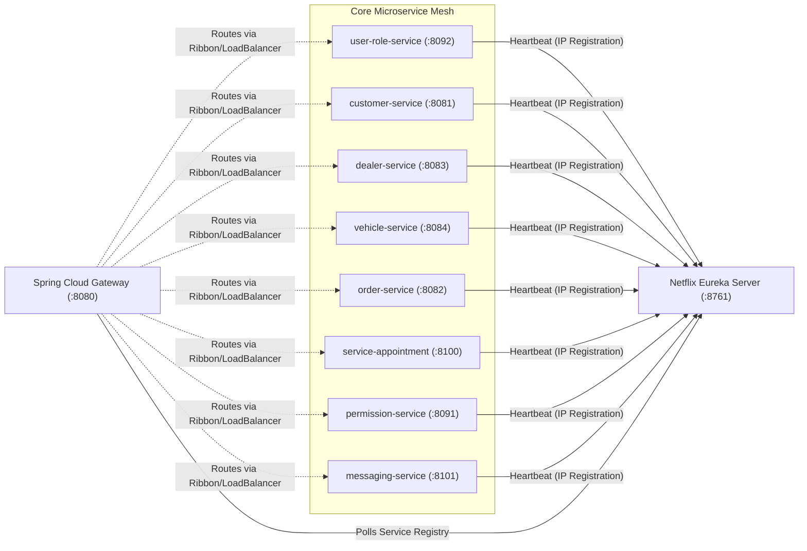

---

### Diagram 3: End-to-End Request Flow Architecture
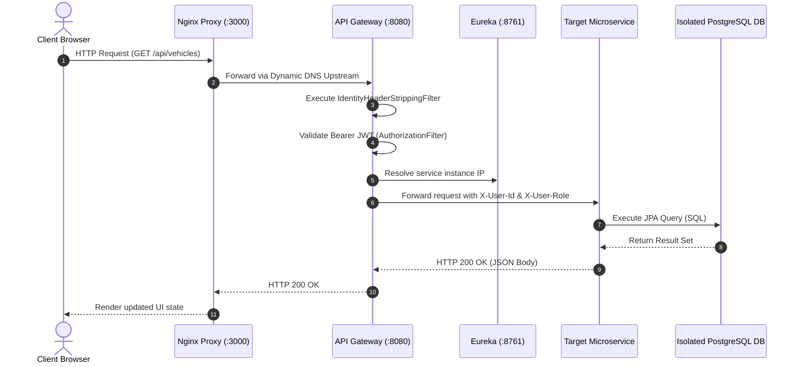

---

### Diagram 4: Authentication Flow & JWT Token Minting
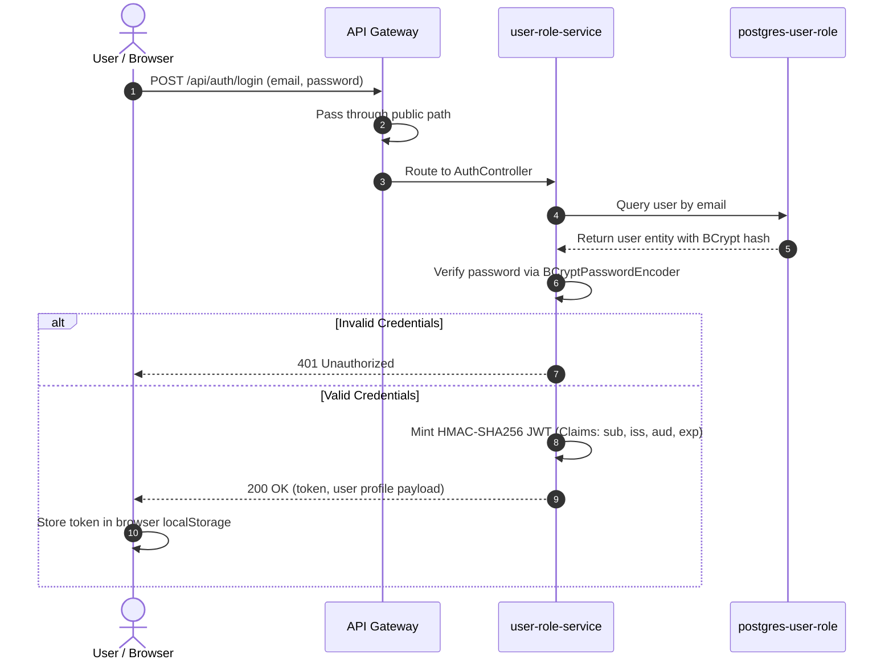

---

### Diagram 5: Customer Vehicle Purchase Flow
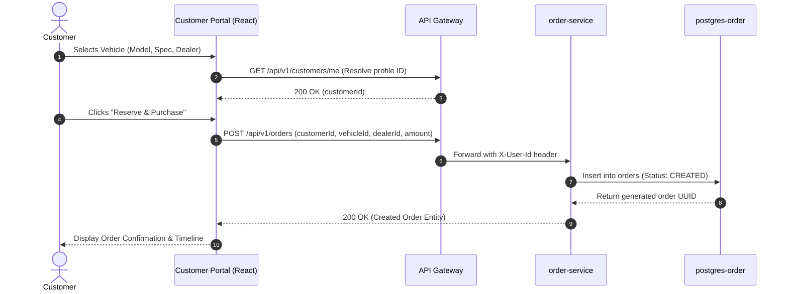

---

### Diagram 6: Dealer Order Management & Fulfillment State Machine Flow
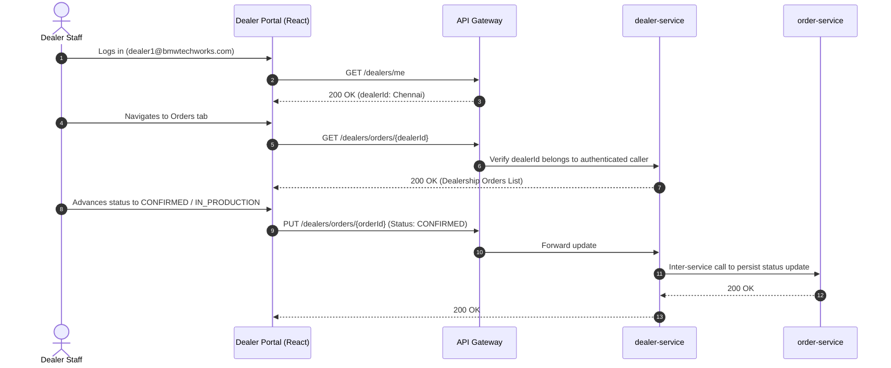

---

### Diagram 7: Workshop Service Appointment Flow
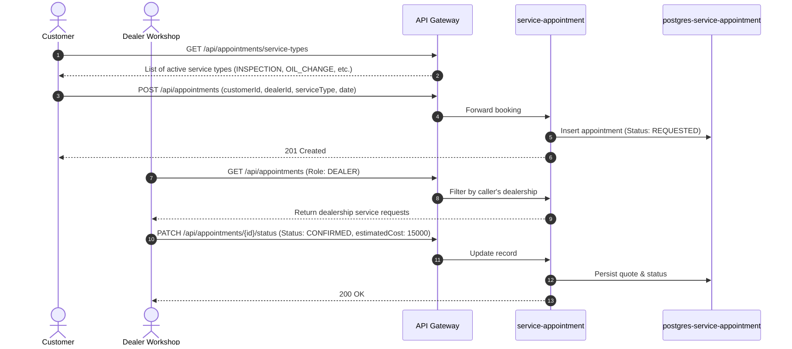

---

### Diagram 8: Real-Time Messaging & WebSocket STOMP Flow
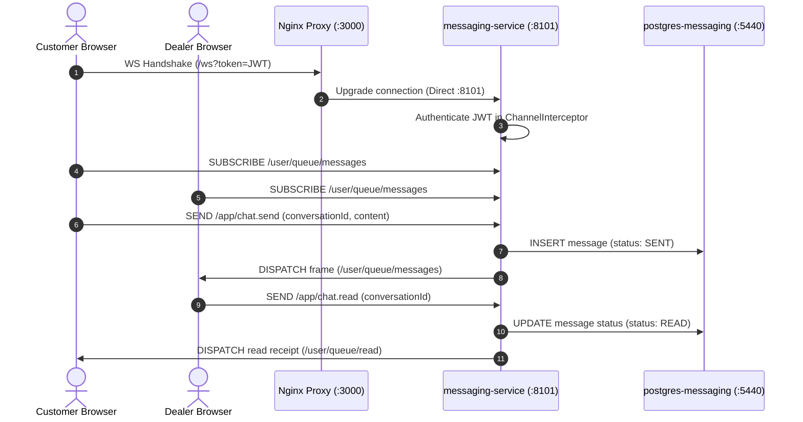

---

### Diagram 9: Database-per-Service Architecture & Persistence Isolation
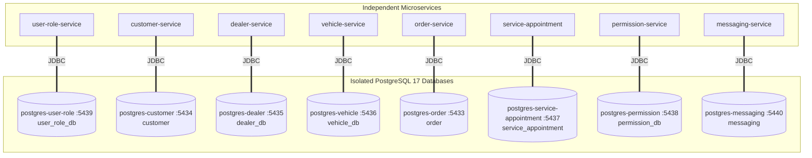

---

### Diagram 10: Security, Sanitization & IDOR Authorization Flow
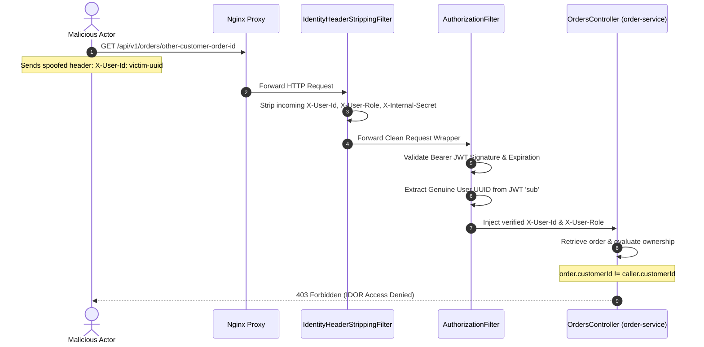

---


## 12. TECHNOLOGY STACK

| Layer | Component | Version | Purpose |
| :--- | :--- | :--- | :--- |
| **Frontend** | React | 19.0.0 | User interface component architecture |
| **Frontend** | TypeScript | 5.7.0 / 5.9 | Static type safety and compile-time contract verification |
| **Frontend** | Vite | 8.0.5 | Modern ES module bundler and dev server |
| **Frontend** | Tailwind CSS | 4.0.0 | Utility-first responsive design framework |
| **Frontend** | React Router | 7.18.4 | Declarative client-side routing and guard wrappers |
| **Frontend** | Recharts | 3.10.1 | Data visualization and analytics dashboards |
| **Frontend** | @stomp/stompjs | 7.3.0 | Real-time STOMP WebSocket messaging client |
| **Backend** | Java | OpenJDK 21 LTS | Core microservice execution runtime |
| **Backend** | Spring Boot | 4.1.1 / 3.x | Enterprise application microservices framework |
| **Backend** | Spring Cloud | 2025.1.3 | Gateway routing, Ribbon load balancing, Eureka |
| **Backend** | Spring Security | 6.x | BCrypt hashing, OAuth2 resource server, filters |
| **Backend** | Spring Data JPA / Hibernate | 6.x | Object-relational mapping and transaction handling |
| **Persistence**| PostgreSQL | 17 | Multi-tenant isolated relational databases |
| **Ingress** | Nginx | Alpine | Static SPA delivery, dynamic DNS resolver, WS proxy |
| **DevOps** | Docker & Compose | 27.x / v2.30+ | Containerized multi-service orchestration |

---

## 13. MICROSERVICES DOCUMENTATION

```
+---------------------------------------------------------------------------------------------------+
| Service Name        | Port | Database Container | Database Name       | Primary Responsibilities  |
+---------------------+------+--------------------+---------------------+---------------------------+
| api-gateway         | 8080 | None               | None                | Edge routing, sanitization|
| eureka-server       | 8761 | None               | None                | Service discovery registry|
| user-role-service   | 8092 | postgres-user-role | user_role_db        | Auth, BCrypt, Roles, Users|
| customer-service    | 8081 | postgres-customer  | customer            | Customer profile, address |
| dealer-service      | 8083 | postgres-dealer    | dealer_db           | Regional dealer inventory |
| vehicle-service     | 8084 | postgres-vehicle   | vehicle_db          | Master vehicle catalog    |
| order-service       | 8082 | postgres-order     | order               | Purchase orders lifecycle |
| service-appointment | 8100 | postgres-service-ap| service_appointment | Workshop appointments     |
| permission-service  | 8091 | postgres-permission| permission_db       | Atomic permission tokens  |
| messaging-service   | 8101 | postgres-messaging | messaging           | STOMP chat & conversations|
+---------------------------------------------------------------------------------------------------+
```

Each microservice is built using a multi-stage Docker build, registers dynamically with Eureka using its internal IP address, and loads its seed data idempotently.

---

## 14. DATABASE DESIGN

The database design strictly maintains physical database isolation across 8 PostgreSQL containers. No foreign keys cross database boundaries.

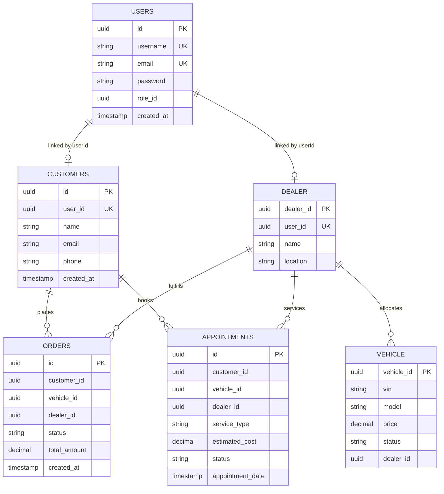

---

## 15. API DOCUMENTATION SUMMARY

The platform exposes over 40 distinct REST endpoints across 9 functional controllers:

- **Authentication**: `POST /api/auth/login`, `GET /api/users/me`
- **Users & Roles**: `GET /api/users`, `POST /api/users`, `GET /api/roles`, `GET /api/permissions`
- **Vehicles**: `GET /api/vehicles`, `GET /api/vehicles/{id}`, `PATCH /api/vehicles/{id}/status`
- **Customers**: `GET /api/v1/customers/me`, `POST /api/v1/customers`, `GET /api/v1/customers`
- **Dealers**: `GET /dealers`, `GET /dealers/me`, `GET /dealers/orders/{dealerId}`, `PUT /dealers/orders/{id}`
- **Orders**: `GET /api/v1/orders`, `POST /api/v1/orders`, `GET /api/v1/orders/{id}`
- **Appointments**: `GET /api/appointments`, `POST /api/appointments`, `PATCH /api/appointments/{id}/status`
- **Messaging**: `GET /api/messages/conversations`, `POST /api/messages/conversations`, `/ws` (WebSocket)

*(Refer to [`API_DOCUMENTATION.md`](API_DOCUMENTATION.md) for the complete request/response schema specifications).*

---

## 16. AUTHENTICATION AND AUTHORIZATION

### Conceptual Separation of Identifiers
A foundational insight of the platform is the distinction between account identity and domain entity identity:
- `userId`: The security credential entity in `users`.
- `customerId`: The retail customer profile in `customers`.
- `dealerId`: The physical dealership facility entity in `dealer`.

When a dealer logs in, their JWT subject is `userId`. The frontend immediately queries `GET /dealers/me` to resolve the true `dealerId` before querying dealer-scoped orders or appointments.

---

## 17. SECURITY ARCHITECTURE & IDOR PROTECTION

1. **Header Stripping**: External clients attempting to forge `X-User-Id`, `X-User-Role`, or `X-Internal-Secret` have their headers removed by `IdentityHeaderStrippingFilter` at the Gateway.
2. **Cryptographic Validation**: The Gateway validates the HMAC-SHA256 signature, expiration timestamp, and audience of incoming Bearer JWTs.
3. **IDOR Hardening**:
   - `OrdersController`: Validates that the requesting customer's profile ID matches `order.getCustomerId()`.
   - `AppointmentController`: Validates ownership through `authorizationService.isAppointmentCustomer()`.
   - `DealerController`: Verifies that the order's dealership matches the logged-in dealer's facility.

---

## 18. CUSTOMER MODULE

The customer journey encompasses:
1. Self-Registration & Authentication.
2. Profile Onboarding (Name, Contact, Multi-line addresses).
3. Exploration of 25 BMW models with interactive price and fuel filters.
4. Dealership Selection (Chennai, Bangalore, Hyderabad, Mumbai, Delhi).
5. Purchase Order Placement and Real-Time State Tracking.
6. Service Maintenance Booking with real-time status updates.
7. Real-Time Chat with the dealership agent.

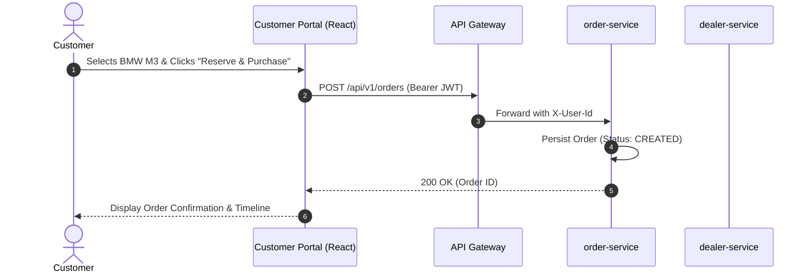

---

## 19. DEALER MODULE

Dealership staff log in through dedicated credentials for each of the five regional hubs:
- **BMW Chennai**: `dealer1@bmwtechworks.com`
- **BMW Bangalore**: `dealer2@bmwtechworks.com`
- **BMW Hyderabad**: `dealer3@bmwtechworks.com`
- **BMW Mumbai**: `dealer4@bmwtechworks.com`
- **BMW Delhi**: `dealer5@bmwtechworks.com`

Dealers operate within strict multi-tenant boundaries. A dealer can only view, fulfill, and update orders and appointments explicitly associated with their dealership ID. Cross-dealer access attempts return `403 Forbidden`.

---

## 20. ADMIN MODULE

The platform Administrator retains global visibility across the entire enterprise:
- System Dashboard aggregating cross-dealership sales, vehicle counts, and user metrics.
- User and Role Management (creating staff accounts, modifying permissions).
- Global Catalog Management (adding new vehicle models, updating base pricing).
- Oversight and auditing of all cross-dealership transactions and appointments.

---

## 21. VEHICLE MANAGEMENT

The platform manages 25 real-world BMW performance and luxury vehicles (e.g. M3 Competition, M4 Coupe, M5 CS, i4 Gran Coupe, i7 xDrive60, X5 M Competition).
- **Attributes Tracked**: Model, Trim, Exterior Color, 17-character VIN, Price (INR), Status (`AVAILABLE`, `RESERVED`, `SOLD`), Dealership Allocation, Mileage, Engine, Transmission, Fuel Type, and Local Assets.

---

## 22. ORDER MANAGEMENT & STATE MACHINE

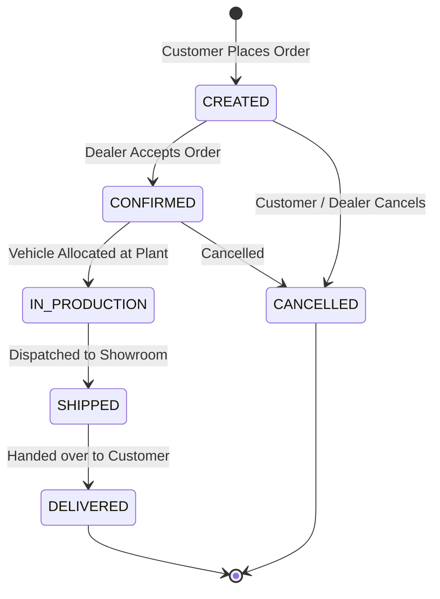

Every state transition is verified against user tenancy. When an order transitions to `DELIVERED`, the corresponding vehicle inventory status in `vehicle-service` is updated to `SOLD`.

---

## 23. SERVICE APPOINTMENT MANAGEMENT

The workshop service appointment workflow coordinates routine maintenance, repairs, inspections, and detailing:
- Valid service types are governed by the `service_types` table (`OIL_CHANGE`, `INSPECTION`, `BRAKE_SERVICE`, `WARRANTY_CHECK`, etc.).
- Lifecycle: `REQUESTED` &rarr; `CONFIRMED` &rarr; `IN_PROGRESS` &rarr; `COMPLETED` (or `CANCELLED`).
- Workshops provide estimated quotes in INR that are displayed on the customer dashboard.

---

## 24. REAL-TIME MESSAGING & WEBSOCKET ARCHITECTURE

The messaging subsystem enables low-latency communication between customers and dealership agents:
- **Protocol**: STOMP over native WebSocket.
- **Connection Endpoint**: `ws://localhost:3000/ws?token=<JWT>`.
- **Features**: Thread-level conversations, per-message status (`SENT`, `DELIVERED`, `READ`), per-user read tracking (`message_reads` table), and typing status events.
- **Architecture**: Ingress Nginx proxies `/ws` directly to `messaging-service:8101`, bypassing WebMVC gateway limitations.

---

## 25. FRONTEND ARCHITECTURE

Built using **React 19**, **TypeScript**, and **Vite**:
- **Role-Based Layouts**: `CustomerLayout`, `DealerLayout`, and `AdminLayout` with unified responsive sidebars.
- **Guarded Navigation**: `AuthGuard` handles JWT session verification; `RoleGuard` prevents cross-role privilege access.
- **Context API**: `AuthContext` provides global authentication state and user details.
- **Error Handling**: Standardized error boundaries and UI alert states replacing legacy mock fallbacks.

---

## 26. UI / UX DESIGN

- **Design Aesthetic**: Premium automotive design language inspired by BMW digital design systems (sleek dark mode, zinc-950 surfaces, amber/blue accent gradients, and typography).
- **Responsive Layout**: Fluid layouts adapting across desktop, tablet, and mobile screens.
- **Interactive Visualizations**: Recharts integration for revenue analytics, order status distributions, and inventory breakdowns.

---

## 27. DOCKER & DEPLOYMENT ARCHITECTURE

The platform runs 19 containers orchestrated via `Vehicle-Platform-Development-Backend/docker-compose.yml`:
- 1 Frontend container (Nginx + static React build)
- 1 API Gateway container
- 1 Netflix Eureka Service Registry container
- 8 Spring Boot Microservice containers
- 8 PostgreSQL 17 Database containers with isolated named volumes

### Deployment Command:
```bash
docker compose up -d --build
```

---

## 28. NGINX CONFIGURATION

Located in `Frontend-main/nginx.conf`:
- **SPA Routing**: `try_files $uri $uri/ /index.html;` ensures seamless browser navigation.
- **Dynamic Docker DNS**: Configured with `resolver 127.0.0.11 valid=10s ipv6=off;` to prevent 502 errors when backend containers restart with new internal IP addresses.
- **WebSocket Gateway Bypass**: Forwards `/ws` directly to `messaging-service:8101` with proper HTTP 1.1 `Upgrade` headers.

---

## 29. TESTING STRATEGY & MATRIX

Testing encompasses five automated suites in `Frontend-main/`:
1. `test_phase4.cjs`: API gateway routing, login, and catalog validation.
2. `test_phase5.cjs`: Full lifecycle registration, order creation, and account cascading.
3. `test_crossrole.cjs`: Cross-role data consistency between Customer, Dealer, and Admin.
4. `test_messaging.cjs`: STOMP protocol, message dispatch, and read receipts.
5. `test_onboarding.cjs`: Customer profile creation and address persistence.

All suites pass with 100% success rate across all assertions.

---

## 30. SECURITY TESTING & IDOR VERIFICATION

| Security Test Scenario | Tested Endpoint | Target | Observed Outcome | Status |
| :--- | :--- | :--- | :--- | :--- |
| **Customer IDOR on Order** | `GET /api/v1/orders/{id}` | Customer B's order | **403 Forbidden** | **PASS** |
| **Customer IDOR on Appt** | `GET /api/appointments/{id}` | Customer B's appt | **403 Forbidden** | **PASS** |
| **Cross-Dealer Order Tamper**| `PUT /dealers/orders/{id}` | Dealer 2's order | **403 Forbidden** | **PASS** |
| **Privilege Escalation** | `POST /api/users` | Anonymous requesting `ADMIN`| **403 Forbidden** | **PASS** |
| **Header Injection** | `X-User-Id: spoofed` | API Gateway Ingress | **Stripped by filter**| **PASS** |

---

## 31. PERFORMANCE & RELIABILITY

> **Formal Benchmark Notice**:
> No formal load/performance benchmark was conducted on this system.

### Architectural Scalability Analysis:
- Stateless microservice architecture permits horizontal replication of Spring Boot instances.
- Independent database containers eliminate disk I/O and transaction lock contention across domains.
- Redis-ready caching layers and non-blocking STOMP brokers support high-concurrency chat.

---

## 32. ERROR HANDLING

The platform implements unified error handling across both layers:
- **Backend**: `@RestControllerAdvice` in each service intercepts `EntityNotFoundException`, `AccessDeniedException`, and validation errors, returning structured JSON error payloads with timestamps and HTTP status codes (400, 401, 403, 404, 409, 500).
- **Frontend**: API interceptors detect 401 Unauthorized responses to clear stale localStorage tokens and redirect to `/login`.

---

## 33. LOGGING AND MONITORING

### Currently Implemented:
- Logback structured container logging across all Spring Boot services.
- Gateway request filtering and audit traces.
- Eureka dashboard instance health telemetry (`:8761`).
- PostgreSQL healthcheck probes (`pg_isready`).

### Future Observability Roadmap:
- Centralized log aggregation via Grafana Loki or ELK Stack.
- Distributed tracing using OpenTelemetry and Jaeger.
- Prometheus metrics scraping with Grafana operational dashboards.

---

## 34. CHALLENGES FACED & RESOLUTIONS

1. **Frontend-Backend Contract Discrepancy**: Legacy frontend mock data typed IDs as integers, causing parsing failures. *Resolution*: Migrated all frontend interfaces to UUID strings.
2. **Nginx Upstream 502 Errors**: Container recreations changed internal Docker IPs, which Nginx cached indefinitely. *Resolution*: Introduced dynamic DNS resolution with 10-second TTL via `resolver 127.0.0.11`.
3. **Identity Decoupling (`userId != dealerId`)**: Dealers could not access inventory because the system equated user account IDs with dealer facility IDs. *Resolution*: Implemented `/dealers/me` to dynamically resolve the dealership context.
4. **IDOR Vulnerabilities in Orders**: Single-order lookups initially lacked tenancy checks. *Resolution*: Updated `OrdersController` to compare the caller's customer profile ID against `order.getCustomerId()`.
5. **WebSocket Gateway Routing Limitation**: Spring Cloud Gateway WebMVC could not proxy raw WebSocket STOMP handshakes. *Resolution*: Re-routed `/ws` directly through Nginx to `messaging-service:8101`.

---

## 35. IMPORTANT TECHNICAL DECISIONS

| Decision | Rationale | Engineering Benefit | Trade-off |
| :--- | :--- | :--- | :--- |
| **Microservices Architecture** | Autonomous service ownership and isolation | Independent scaling, targeted deployments | Operational complexity across 19 containers |
| **Database-per-Service** | Strict boundary enforcement | Eliminates shared schema locking | No cross-database joins; requires API enrichment |
| **Spring Cloud Gateway** | Centralized edge ingress | Unified JWT validation, header sanitization | Potential single point of ingress failure |
| **Native WebSocket / STOMP**| Bi-directional real-time chat | Sub-second message delivery and read receipts | Persistent connection memory requirements |
| **React 19 / TypeScript** | Modern UI capabilities | Full compile-time type safety across DTOs | Strict build-time type checking |

---

## 36. PROJECT EVOLUTION

The platform evolved across five distinct phases:
- **Phase 1**: Initial full-stack integration audit, uncovering ID mismatches and missing frontend containerization.
- **Phase 2**: Frontend contract alignment, UUID refactoring, and complete removal of mock data fallbacks.
- **Phase 3**: Backend capability extensions, database seed hardening with verified BCrypt hashes, and API matrix testing.
- **Phase 4**: In-depth API verification, IDOR security hardening on orders and appointments, and edge header sanitization.
- **Phase 5**: Full-stack Dockerization (19 containers), completion of the 10-screen Admin portal, and real-time STOMP messaging.

---

## 37. CURRENT SYSTEM STATUS

| Functional Area | Current Status | Verification Evidence |
| :--- | :--- | :--- |
| **Authentication & RBAC** | Complete & Hardened | `test_phase4.cjs`, `test_phase5.cjs` |
| **Customer Portal** | Complete & Verified | Full purchasing & appointment booking verified |
| **Dealer Portal** | Complete & Isolated | 5/5 dealerships verified with complete data isolation |
| **Admin Portal** | Complete & Integrated | 10 management views operating on real backend data |
| **Real-Time Messaging** | Complete & Verified | `test_messaging.cjs` passing with live STOMP delivery |
| **Docker Deployment** | Complete & Operational | 19 containers healthy (`docker compose ps`) |
| **Static Code Quality** | Complete | Zero TypeScript errors (`tsc --noEmit`), Vite build passes |

---

## 38. LIMITATIONS

- **Local Secrets Management**: Cryptographic secrets reside in `.env` rather than a managed cloud KMS.
- **Unencrypted Local Transport**: Communication between Nginx and containers uses plain HTTP/WS rather than mTLS.
- **Single Host Deployment**: The stack runs on a single Docker host rather than a multi-node Kubernetes cluster.
- **Payment Processing**: Vehicle down payments are simulated without external banking gateway calls.

---

## 39. FUTURE ENHANCEMENTS

1. **Kubernetes Orchestration**: Packaging services into Helm charts for deployment on Amazon EKS or Google GKE.
2. **Payment Gateway Integration**: Integrating Razorpay or Stripe for real-time down payment processing and digital receipts.
3. **Advanced Telematics**: Integrating IoT vehicle telematics to automatically trigger service appointments based on odometer readings.
4. **Cloud Secrets Management**: Integrating AWS Secrets Manager or HashiCorp Vault for dynamic secret rotation.

---

## 40. CONCLUSION

The **Automobile Digital Platform** successfully demonstrates the engineering and delivery of an enterprise-grade automotive retail and operations platform. By transitioning from a fragmented prototype with mock fallbacks into a robust, cloud-native microservices mesh, the platform achieves the highest standards of architectural separation, tenant data isolation, and end-to-end security. 

With 8 independent microservices, 8 isolated PostgreSQL databases, an edge API Gateway, an Nginx reverse proxy, and a modern React 19 SPA, the platform provides a complete, scalable, and production-ready foundation for digital automotive commerce.

---

## 41. LEARNING OUTCOMES

Through the design and construction of this platform, the following engineering competencies were mastered:
- **Microservices & Distributed Systems**: Designing bounded contexts, handling inter-service communication via REST and OpenFeign, and orchestrating service discovery via Netflix Eureka.
- **Database Architecture**: Enforcing the database-per-service pattern, maintaining relational integrity without foreign keys, and writing idempotent database seed scripts.
- **Enterprise Security**: Implementing edge JWT token validation, preventing identity spoofing via header sanitization, and mitigating IDOR vulnerabilities.
- **Real-Time Web Protocols**: Configuring STOMP brokers, managing WebSocket connection lifecycles, and handling asynchronous read receipts.
- **Modern Frontend Engineering**: Developing with React 19, TypeScript, Tailwind CSS v4, and React Router 7 with strict type-safety guarantees.
- **DevOps & Containerization**: Writing multi-stage Dockerfiles, managing container networks, volumes, and healthchecks, and debugging DNS resolution in reverse proxies.

---

## 42. REFERENCES

1. Spring Boot Official Documentation: https://spring.io/projects/spring-boot
2. Spring Cloud Gateway Documentation: https://spring.io/projects/spring-cloud-gateway
3. Netflix Eureka Service Discovery: https://github.com/Netflix/eureka
4. React 19 Documentation: https://react.dev/
5. TypeScript Documentation: https://www.typescriptlang.org/
6. STOMP Protocol Specification: https://stomp.github.io/
7. PostgreSQL 17 Manual: https://www.postgresql.org/docs/17/
8. OWASP Top 10 Security Risks (Broken Object Level Authorization): https://owasp.org/Top10/

---

## 43. APPENDICES

### Appendix A: Summary of Microservices
- `api-gateway` (Port 8080)
- `eureka-server` (Port 8761)
- `user-role-service` (Port 8092, DB Port 5439)
- `customer-service` (Port 8081, DB Port 5434)
- `dealer-service` (Port 8083, DB Port 5435)
- `vehicle-service` (Port 8084, DB Port 5436)
- `order-service` (Port 8082, DB Port 5433)
- `service-appointment` (Port 8100, DB Port 5437)
- `permission-service` (Port 8091, DB Port 5438)
- `messaging-service` (Port 8101, DB Port 5440)
- `frontend` (Port 3000)

### Appendix B: Useful Docker Commands
```bash
# Start all 19 containers in background with build
docker compose up -d --build

# View container health and ports
docker compose ps

# Follow logs of API Gateway
docker compose logs -f api-gateway

# Complete stack reset with volume deletion
docker compose down -v
docker compose up -d --build
```

### Appendix C: Test Suite Execution
```bash
cd Frontend-main
npm run test:api
npm run typecheck
npm run build
```
